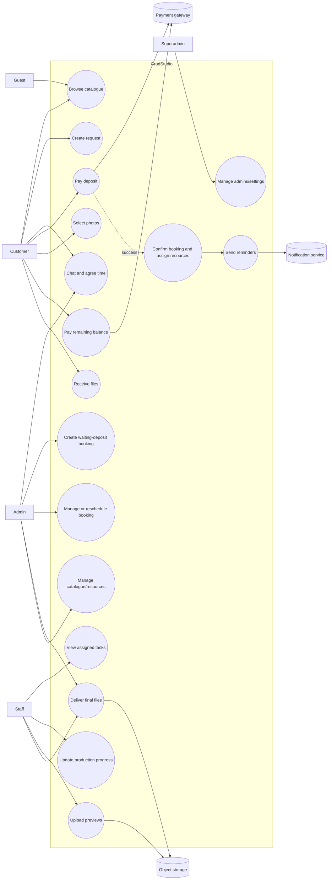
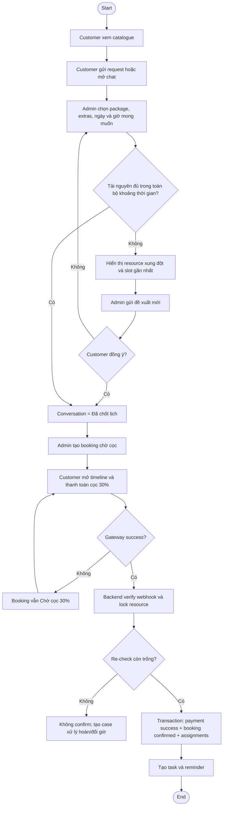
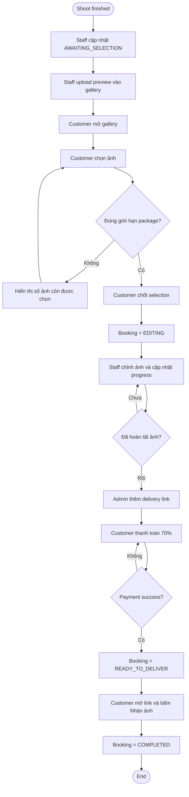
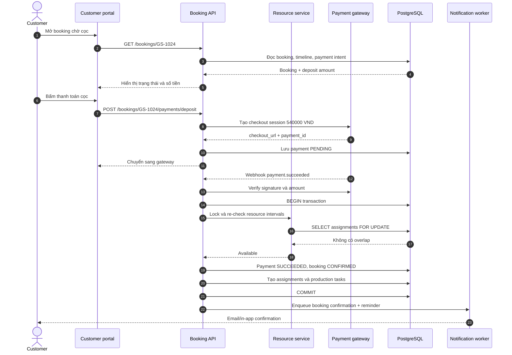
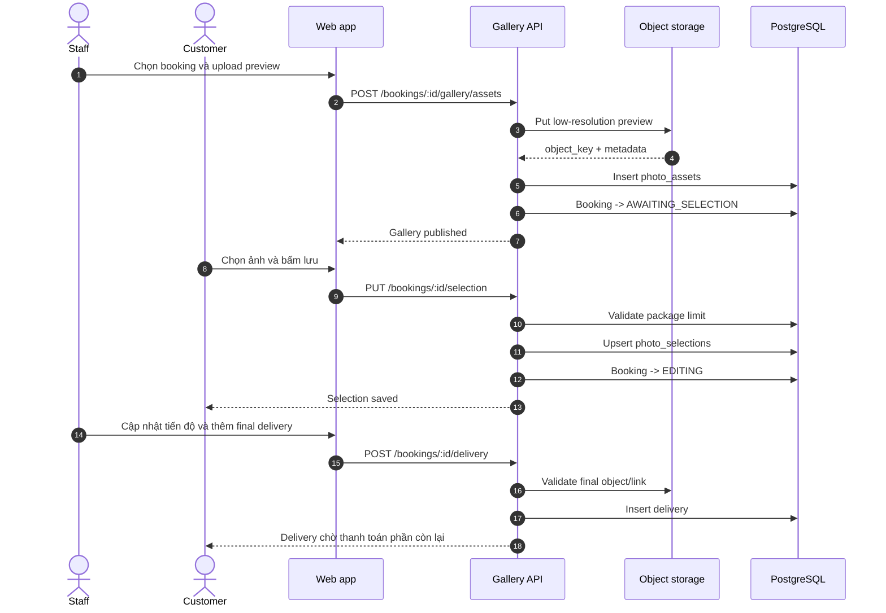

# 02. UML và business-flow diagrams

Các diagram dùng Mermaid. GitHub và nhiều extension VS Code có thể render trực tiếp các code block `mermaid`.

## 1. Use-case diagram



## 2. Activity - tư vấn, cọc và giữ lịch



## 3. Activity - chọn ảnh, thanh toán phần còn lại và nhận file



## 4. Sequence - tạo booking và confirm sau cọc



## 5. Sequence - gallery và delivery



## 6. Sequence - reschedule/cancel

```mermaid
sequenceDiagram
    autonumber
    actor Admin
    participant Web as Admin console
    participant API as Booking API
    participant Scheduler as Resource service
    participant DB as PostgreSQL
    participant Notify as Notification worker

    Admin->>Web: Mở booking CONFIRMED
    Admin->>Web: Nhập giờ mới và lý do
    Web->>API: POST /bookings/:id/reschedule
    API->>Scheduler: Check new intervals
    Scheduler->>DB: Query overlap by resource
    DB-->>Scheduler: Available / conflict details
    alt Available
        Scheduler-->>API: New slot available
        API->>DB: BEGIN; update schedule + assignments; COMMIT
        API->>Notify: Enqueue change notification
        API-->>Web: Rescheduled
    else Conflict
        Scheduler-->>API: Conflict with resource name and interval
        API-->>Web: Show actionable conflict message
    end
```
