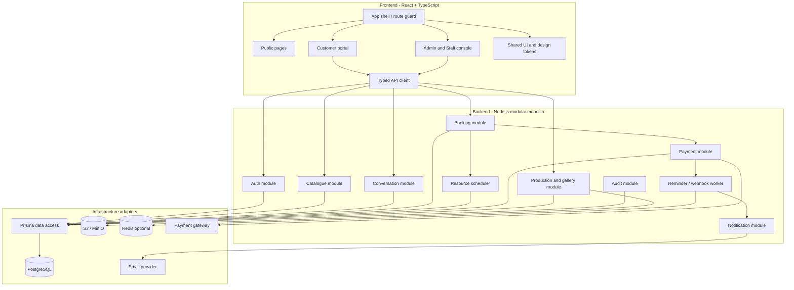
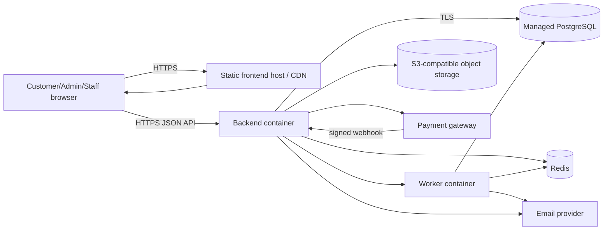

# 04. Development view và deployment view

## 1. Khuyến nghị stack cho đồ án

| Layer | Đề xuất | Lý do |
| --- | --- | --- |
| Frontend | React + TypeScript + Vite | Component hóa UI, dễ làm responsive và route |
| Styling | CSS Modules hoặc Tailwind, chọn một | Tránh style global khó kiểm soát |
| Backend | Node.js + TypeScript + Express/Fastify | Cùng ngôn ngữ, dễ chia sẻ type |
| ORM | Prisma | Migration, type-safe query, schema dễ review |
| Database | PostgreSQL 16 | Transaction, constraint overlap, enum/check |
| Auth | Cookie session hoặc JWT ngắn hạn + refresh | Phù hợp web app; không lưu token trong localStorage nếu không cần |
| File storage | S3-compatible storage / MinIO local | Preview và final file không nằm trong DB |
| Async job | BullMQ + Redis, hoặc DB job table ở bản đầu | Reminder/email không chặn request chính |
| Test | Vitest/Jest + Supertest + Playwright | Unit, API và smoke flow |
| Local runtime | Docker Compose | Cùng môi trường cho cả nhóm |

### Quyết định giảm rủi ro

Bản đầu nên làm **modular monolith**, không tách microservice. Scheduler, Payment, Gallery là module trong một backend; chỉ Notification worker có thể chạy process riêng khi cần. Cách này phù hợp nhóm sinh viên, dễ debug và vẫn có boundary rõ.

## 2. Development view



## 3. Module responsibilities

| Module | Owns | Must not own |
| --- | --- | --- |
| Auth | login, role, session, permission | booking status rules |
| Catalogue | packages, extras, portfolio, reviews | actual resource availability |
| Conversation | threads, messages, agreement snapshot | payment confirmation |
| Booking | booking lifecycle, timeline, price snapshot | raw gateway credentials |
| Scheduler | resource types, assignments, overlap checks | customer-facing copy |
| Payment | payment intent, webhook, payment state | manually deciding booking status without Booking service |
| Production | tasks, gallery, selection, delivery | user authentication |
| Notification | in-app notification, email job | payment source of truth |
| Audit | append-only event records | mutable business tables |

## 4. API boundary draft

```text
POST   /api/auth/login
GET    /api/catalogue/packages
GET    /api/catalogue/packages/:id
POST   /api/conversations
GET    /api/conversations/:id
POST   /api/conversations/:id/messages
POST   /api/conversations/:id/proposals
POST   /api/conversations/:id/agree
POST   /api/bookings
GET    /api/bookings/:id
POST   /api/bookings/:id/payments/deposit
POST   /api/bookings/:id/reschedule
POST   /api/bookings/:id/cancel
POST   /api/payment/webhook
GET    /api/bookings/:id/gallery
POST   /api/bookings/:id/gallery/assets
PUT    /api/bookings/:id/selection
POST   /api/bookings/:id/payments/balance
POST   /api/bookings/:id/delivery
POST   /api/bookings/:id/receive
GET    /api/staff/tasks
PATCH  /api/staff/tasks/:id
```

## 5. Deployment view



### Local deployment

```text
Docker Compose
├── web       (optional nginx or Vite dev server)
├── api       (Node.js)
├── postgres  (database)
├── minio     (object storage)
└── redis     (optional, can be added when reminder worker starts)
```

### Production deployment

- frontend: static host/CDN;
- API and worker: two containers from the same repository;
- database: managed PostgreSQL with daily backup;
- object storage: private bucket with signed URLs;
- secrets: environment variables from platform secret manager;
- logs: structured JSON with request id;
- monitoring: health endpoint, error tracking, payment webhook alert.

## 6. Security and reliability baseline

- RBAC kiểm tra ở backend, không chỉ ẩn menu frontend.
- Customer chỉ được xem booking mà mình sở hữu.
- Staff chỉ được xem task/asset trong phạm vi được phân công hoặc quyền Admin.
- Webhook payment phải verify chữ ký và idempotency key.
- Không lưu số thẻ; chỉ lưu gateway payment id và trạng thái.
- Signed URL có hạn cho preview/final file.
- Soft delete catalogue/resource; không xóa booking/payment lịch sử.
- Booking transition đi qua service method, không cho controller đổi status tùy ý.
