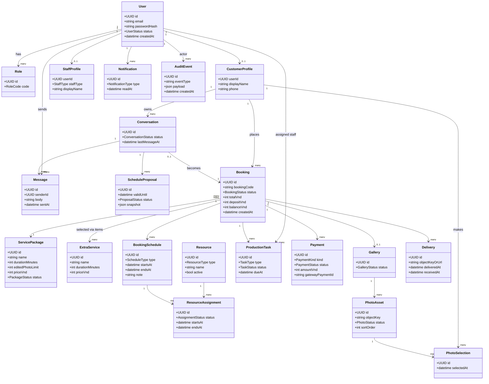

# 05. Class diagram và domain model

## 1. Nguyên tắc model

- `Booking` là aggregate root cho phần nghiệp vụ xuyên suốt.
- `Conversation` có thể tồn tại trước booking; khi booking được tạo, lưu `conversation_id`.
- `BookingSchedule` tách khỏi booking để hỗ trợ nhiều mốc như makeup và shoot.
- `ResourceAssignment` tách khỏi `BookingSchedule` để một mốc có nhiều nhân sự/phòng/trang phục.
- `Payment` là immutable transaction record theo gateway event; cập nhật trạng thái có audit.
- `PhotoAsset` lưu metadata; binary file nằm object storage.

## 2. Class diagram



## 3. Service methods cần giữ invariant

```text
ConversationService.agreeProposal(conversationId, proposalId)
BookingService.createWaitingDepositBooking(input)
BookingService.confirmAfterDeposit(bookingId, paymentId)
SchedulerService.checkAvailability(intervals, resourceRequirements)
SchedulerService.confirmAssignments(bookingId)
BookingService.reschedule(bookingId, newSchedule, actor)
GalleryService.saveSelection(bookingId, assetIds, customerId)
PaymentService.handleWebhook(event)
DeliveryService.markReceived(bookingId, customerId)
```

Không cho controller tự sửa `Booking.status`. Các transition phải qua service để kiểm tra quyền, state hiện tại và side effects.

## 4. Enum đề xuất

```text
RoleCode: CUSTOMER | STAFF | ADMIN | SUPERADMIN
ConversationStatus: CHUA_TRA_LOI | DANG_TU_VAN | DA_CHOT_LICH | HOAN_THANH
BookingStatus: DRAFT | AGREED_WAITING_DEPOSIT | CONFIRMED | PREPARING |
               SHOOT_IN_PROGRESS | AWAITING_SELECTION | EDITING |
               READY_TO_DELIVER | COMPLETED | RESCHEDULE_REQUESTED | CANCELLED
PaymentKind: DEPOSIT | BALANCE | REFUND
PaymentStatus: PENDING | SUCCEEDED | FAILED | CANCELLED | REFUNDED
ResourceType: PHOTOGRAPHER | MAKEUP_ARTIST | ROOM | COSTUME
TaskType: MAKEUP | SHOOT | SELECT_REVIEW | EDIT | DELIVERY
TaskStatus: TODO | IN_PROGRESS | BLOCKED | DONE
```
