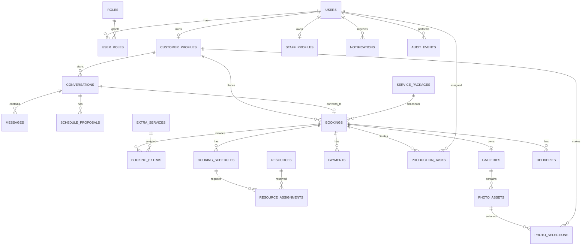

# 06. Database design

## 1. Database choice

Chọn PostgreSQL vì cần transaction cho thanh toán cọc, `SELECT ... FOR UPDATE` khi confirm booking và exclusion constraint cho các resource assignment bị overlap. Giá tiền lưu kiểu `integer` theo VND.

## 2. Entity relationship diagram



## 3. Table responsibilities

| Table | Trách nhiệm |
| --- | --- |
| users, roles, user_roles | identity và RBAC |
| customer_profiles, staff_profiles | dữ liệu mở rộng theo role |
| service_packages, extra_services | catalogue |
| conversations, messages, schedule_proposals | tư vấn và thỏa thuận |
| bookings, booking_extras, booking_schedules | aggregate booking và snapshot giá |
| resources, resource_assignments | lịch nhân sự/phòng/trang phục |
| payments | payment intent và gateway events |
| production_tasks | việc makeup, shoot, edit, delivery |
| galleries, photo_assets, photo_selections | preview và lựa chọn ảnh |
| deliveries | file hoàn thiện và xác nhận nhận |
| notifications, audit_events | thông báo và truy vết |

## 4. PostgreSQL schema starter

File chạy setup: [`database/schema.sql`](database/schema.sql).

Các điểm cần chú ý trong schema:

- `booking_code` unique và human-readable;
- package/extras được snapshot vào booking để lịch sử không đổi khi catalogue đổi giá;
- `resource_assignments` có exclusion constraint cho trạng thái `HELD` và `CONFIRMED`;
- payment có `gateway_event_id` unique để webhook idempotent;
- bảng lịch sử không hard delete.

## 5. Transaction confirm booking

```text
BEGIN
  1. SELECT booking FOR UPDATE
  2. SELECT payment intent FOR UPDATE và verify amount/status
  3. SELECT resource assignments cùng resource FOR UPDATE
  4. Check overlap cho toàn bộ BookingSchedule
  5. Nếu có overlap -> rollback, tạo case xử lý
  6. Mark payment SUCCEEDED
  7. Update booking CONFIRMED
  8. Insert resource_assignments CONFIRMED
  9. Insert production_tasks
 10. Insert notification outbox/audit event
COMMIT
```

## 6. Index và query cần có

```text
users(email)
conversations(customer_id, status, last_message_at desc)
bookings(customer_id, status, created_at desc)
booking_schedules(booking_id, starts_at)
resource_assignments(resource_id, starts_at, ends_at)
payments(booking_id, kind, status)
production_tasks(assignee_id, status, due_at)
photo_assets(gallery_id, sort_order)
notifications(user_id, read_at, created_at desc)
```

## 7. Data retention và file rules

- preview/final file không lưu binary trong PostgreSQL;
- xóa booking không xóa payment/audit; dùng status `CANCELLED`;
- object key chứa `booking_id/gallery_id`, không chứa email hoặc thông tin nhạy cảm;
- signed URL của final file có thời hạn và chỉ phát sau khi đủ điều kiện giao file.
